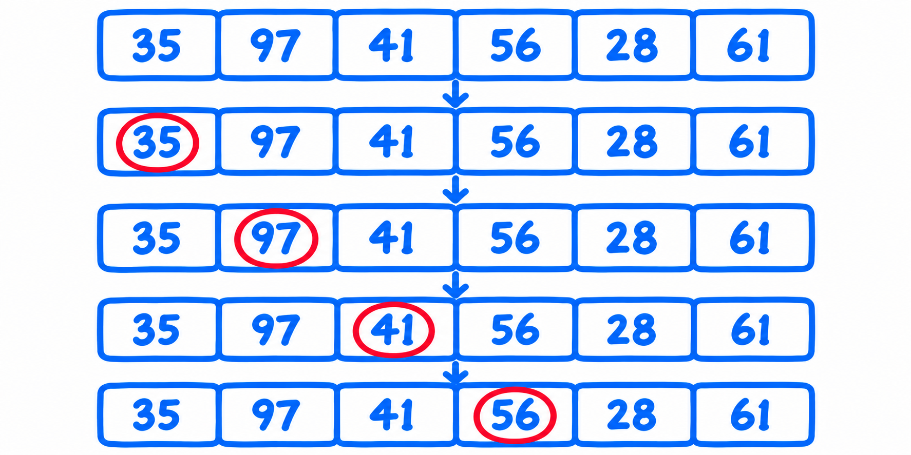
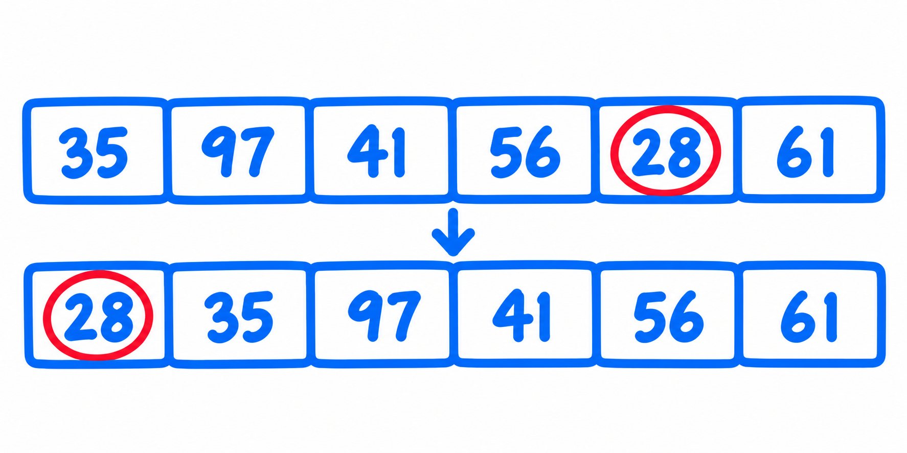
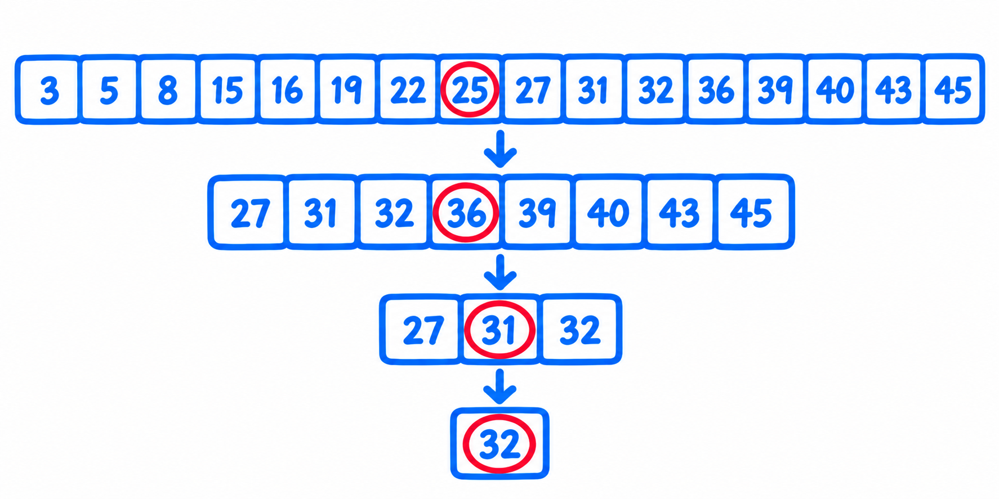
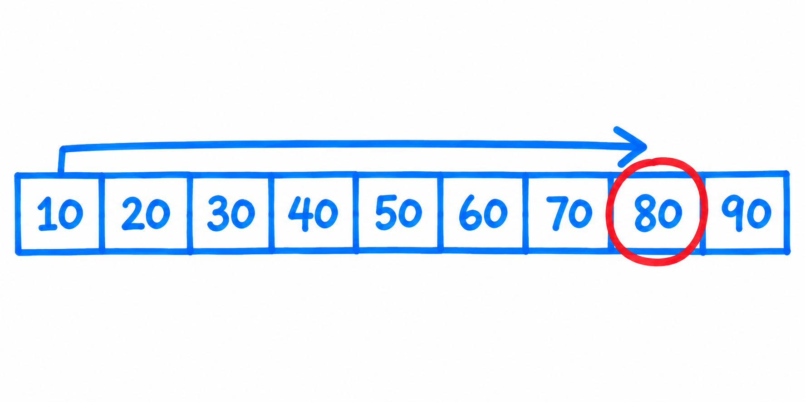
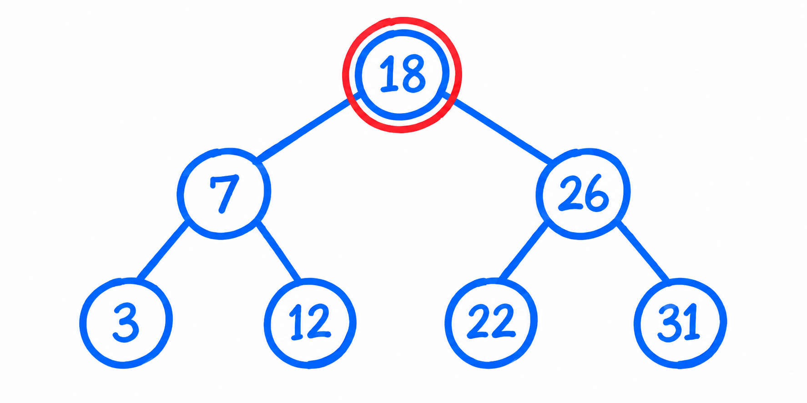
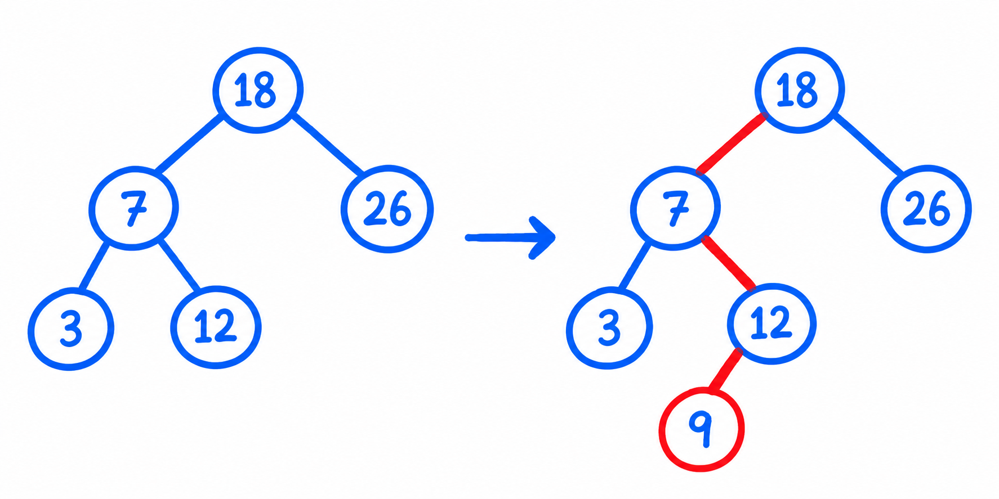
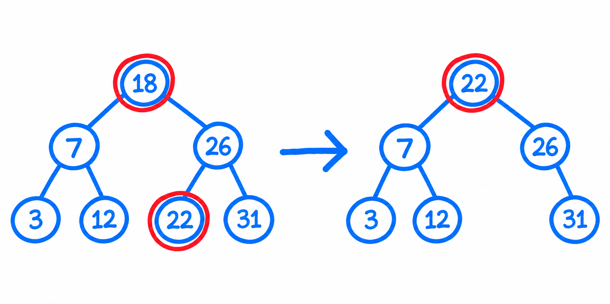

## 0. 학습목표

**탐색(search)**은 데이터 집합에서 원하는 데이터를 찾는 작업이다. 어떤 탐색 알고리즘이 유리한지는 데이터가 정렬되어 있는지, 어떤 구조에 저장되어 있는지, 삽입과 삭제가 얼마나 자주 일어나는지에 따라 달라진다.

| 상황 | 먼저 떠올릴 방법 |
| --- | --- |
| 정렬되지 않은 데이터 | 순차 탐색 |
| 정렬된 배열에서 반복해서 검색 | 이진 탐색 |
| 탐색과 삽입·삭제가 모두 필요 | 이진 탐색 트리 |
| 값이 비교적 균등하게 분포 | 보간 탐색도 검토 |

## 1. 탐색이란?

탐색은 **테이블(table)**에서 원하는 **탐색키(search key)**를 가진 **레코드(record)**를 찾는 일이다. 예를 들어 `(학번, 이름, 학과)`가 한 학생의 레코드라면 학번이나 이름을 탐색키로 사용할 수 있다.

- **레코드**: 하나의 데이터 묶음
- **필드**: 레코드를 이루는 각 항목
- **탐색키**: 찾을 때 기준으로 삼는 필드
- **테이블**: 레코드들의 모음

코딩테스트에서는 “얼마나 빨리 찾는가?”와 함께 “새 데이터를 넣거나 지울 때 얼마나 드는가?”도 살펴야 한다. 정렬된 배열은 검색에 유리하지만, 중간에 원소를 넣거나 지울 때 다른 원소들을 이동시켜야 한다.

## 2. 순차 탐색

**순차 탐색(sequential search)** 또는 **선형 탐색(linear search)**은 처음부터 끝까지 원소를 하나씩 비교한다. 정렬되지 않은 데이터에도 사용할 수 있고, 배열과 연결 리스트 모두에 적용할 수 있다.

예를 들어 `[35, 97, 41, 56, 28, 61]`에서 56을 찾으려면 `35 → 97 → 41 → 56`을 차례로 비교한다.


{: .study-diagram }

```python
def sequential_search(a, key, low, high):
    for i in range(low, high + 1):
        if a[i] == key:
            return i
    return -1
```

`low`와 `high`는 모두 탐색 범위에 포함한다. 끝까지 찾지 못하면 `-1`을 반환한다.

### 순차 탐색은 얼마나 빠를까요?

| 경우 | 비교 횟수 | 시간 복잡도 |
| --- | --- | --- |
| 첫 원소에서 발견 | 1번 | O(1) |
| 마지막에서 발견하거나 없음 | 최대 n번 | O(n) |
| 평균적인 탐색 | n에 비례 | O(n) |

### 순차 탐색의 특징

구현이 단순하고 정렬이 필요 없다. 다만 데이터가 커질수록 탐색 시간이 데이터 수에 비례해 늘어난다. 입력 크기가 큰 문제에서 순차 탐색을 여러 번 반복한다면 전체 시간 복잡도가 O(n²)까지 커질 수 있다.

### 순차 탐색을 개선하는 방법은?

**자주 찾는 원소를 앞에 두면** 이후 검색의 평균 비교 횟수를 줄일 수 있다. 이런 방식을 **자기 구성 리스트(self-organizing list)**라고 한다. 검색 패턴이 반복될 때 효과가 있다.

#### 맨 앞으로 보내기(move to front)

찾은 원소를 리스트 맨 앞으로 옮긴다. 같은 원소를 곧 다시 찾을 가능성이 높을 때 유리하다. 배열에서는 앞선 원소들을 밀어야 하므로 이동에 O(n)이 들 수 있다. 연결 리스트에서는 이전 노드를 알고 있다면 링크를 바꿔 옮길 수 있다.


{: .study-diagram }

#### 교환하기(transpose)

찾은 원소를 바로 앞 원소와 교환한다. 자주 검색되는 원소가 조금씩 앞으로 이동한다. 배열에서 교환 자체는 O(1)이지만, **원소를 찾는 과정은 여전히 O(n)**이다.

원소별 검색 횟수를 세어 많이 검색된 순서대로 재배치하는 방법도 있다. 이러한 전략은 과거에 자주 찾은 원소를 앞으로도 자주 찾을 때 도움이 된다.

### Quiz

1. 정렬되지 않은 테이블에서도 동작하는 탐색은? → **순차 탐색**
2. 맨 앞으로 보내기를 배열에서 구현하면 왜 이동 비용이 드는가? → 앞에 있던 원소들을 한 칸씩 밀어야 하기 때문이다.
3. 교환하기 전략을 써도 최악의 탐색 시간은? → **O(n)**

## 3. 이진 탐색

**이진 탐색(binary search)**은 **정렬된 배열**의 가운데 원소를 확인하고, 탐색키가 있을 수 없는 절반을 버린다. 매번 후보 범위가 절반가량 줄어든다.

예를 들어 가운데 값이 25인데 32를 찾는다면 25와 그 왼쪽 원소들은 더 확인할 필요가 없다. 범위가 없어져 `low > high`가 되면 탐색 실패다.


{: .study-diagram }

### 이진 탐색 알고리즘

```python
def binary_search(a, key, low, high):
    while low <= high:
        middle = (low + high) // 2

        if a[middle] == key:
            return middle
        elif a[middle] < key:
            low = middle + 1
        else:
            high = middle - 1

    return -1
```

재귀로도 같은 원리를 구현할 수 있다. 코딩테스트에서는 범위가 **양끝 포함인지** 확인하고, 가운데 원소를 검사한 뒤 `middle`을 다시 포함하지 않도록 `+1` 또는 `-1`로 경계를 옮기는 것이 중요하다.

### 헬로 파이썬 — 파이썬의 나눗셈 연산자

배열 인덱스는 정수여야 하므로 가운데 위치를 계산할 때 `//`를 쓴다. `/`의 결과는 실수다.

### 이진 탐색은 얼마나 빠를까요?

한 번 비교할 때마다 후보 수가 절반으로 줄어들므로 시간 복잡도는 **O(log n)**이다. 최선은 가운데에서 바로 찾는 O(1), 최악은 O(log n)이다.

### 이진 탐색의 특징

- **정렬된 데이터**가 전제다.
- 배열에서는 가운데 원소에 바로 접근할 수 있다.
- 정렬된 배열의 중간에 원소를 삽입하거나 삭제하면 다른 원소를 이동해야 하므로 최악 O(n)이 든다.
- 탐색이 잦고 데이터 변경이 드물 때 특히 적합하다.

💡 코테 포인트

“정렬된 배열에서 특정 값을 찾는다”면 이진 탐색을 먼저 생각한다. 문제에서 답의 범위에 대해 참·거짓이 한 방향으로 바뀐다면, 배열 원소 대신 **정답 범위에 이진 탐색**을 적용할 수도 있다.

### 잠깐만 — 연결된 구조(연결 리스트)에서의 이진 탐색

배열은 `middle` 인덱스로 바로 접근하지만 연결 리스트는 가운데 노드까지 하나씩 따라가야 한다. 가운데를 찾는 비용이 반복되므로 연결 리스트에서는 이진 탐색의 이점이 크게 줄어든다.

### 보간 탐색

**보간 탐색(interpolation search)**은 항상 정중앙을 확인하는 대신 **값의 크기를 이용해 위치를 예측**한다. 값들이 고르게 분포할수록 예측이 잘 맞는다.


{: .study-diagram }

$$
\text{예상 위치} = low + (high-low)\frac{key-A[low]}{A[high]-A[low]}
$$

예를 들어 10부터 90까지 10씩 증가하는 배열에서 80은 정중앙보다 오른쪽에 있을 가능성이 높다. 구현할 때는 `key`가 양끝 값의 범위에 있는지 확인하고, `A[high] == A[low]`라면 0으로 나누지 않도록 처리해야 한다.

보간 탐색은 **균등한 분포라는 가정**에 성능이 좌우된다. 분포가 고르지 않으면 예측 위치가 한쪽으로 치우쳐 최악 O(n)까지 느려질 수 있다. 일반적인 정렬 배열 탐색에서는 이진 탐색을 기본으로 생각하는 편이 안전하다.

### 헬로 파이썬

예상 위치를 배열 인덱스로 사용할 때는 정수로 바꿔야 한다. `int(...)`는 실수나 숫자 문자열을 정수로 변환할 때 사용할 수 있다.

### Quiz

1. 이진 탐색의 최선과 최악 시간 복잡도는? → **O(1), O(log n)**
2. 삽입과 삭제가 빈번한 정렬 배열에서 주의할 비용은? → 원소 이동에 드는 **O(n)**
3. 보간 탐색의 핵심 가정은? → **값과 위치가 대체로 비례한다.**

## 4. 이진 탐색 트리

**이진 탐색 트리(BST, Binary Search Tree)**는 탐색을 위해 키의 대소 관계를 유지하는 이진 트리다. 트리의 높이가 낮게 유지된다면 탐색뿐 아니라 삽입과 삭제도 효율적으로 처리할 수 있다.

### 이진 탐색 트리의 조건

모든 노드에 대해 **왼쪽 서브트리의 모든 키 < 현재 키 < 오른쪽 서브트리의 모든 키**를 만족해야 한다. 바로 옆 자식만 확인하는 것으로는 부족하며, 각 서브트리 전체가 조건을 지켜야 한다. 이 장에서는 중복 키를 허용하지 않는다.


{: .study-diagram }

BST를 **중위 순회하면 키가 오름차순**으로 나온다. 위 그림은 `3 → 7 → 12 → 18 → 22 → 26 → 31` 순서로 방문한다.

### 이진 탐색 트리의 탐색 연산

루트에서 시작해 키를 비교한다. 찾는 키가 작으면 왼쪽으로, 크면 오른쪽으로 이동한다. 같은 키를 만나면 성공하고, 다음 노드가 없으면 실패한다.

#### 노드 클래스 BSTNode

노드는 탐색 기준인 `key`, 나머지 데이터인 `value`, 두 자식 링크 `left`, `right`를 갖는다.

```python
class BSTNode:
    def __init__(self, key, value):
        self.key = key
        self.value = value
        self.left = None
        self.right = None
```

#### 탐색 알고리즘: 키를 이용한 탐색

```python
def search_bst(node, key):
    while node is not None:
        if key == node.key:
            return node
        node = node.left if key < node.key else node.right
    return None
```

한 번에 한 경로만 따라가므로 방문하는 노드 수는 트리 높이 `h`에 비례한다.

#### 탐색 알고리즘: 값을 이용한 탐색

트리는 **키를 기준으로** 배치되어 있다. `value`만 알고 찾는다면 어느 방향에 있는지 결정할 수 없어 모든 노드를 순회해야 할 수 있다. 따라서 최악 O(n)이다.

### 이진 탐색 트리의 삽입 연산

새 키가 들어갈 방향으로 내려가다가 빈 자리를 만나면 노드를 연결한다. 이미 같은 키가 있으면 이 장의 규칙에 따라 삽입하지 않는다.


{: .study-diagram }

재귀 구현에서는 각 호출이 **해당 서브트리의 새 루트**를 반환한다. 부모는 그 결과로 자식 링크를 다시 연결해야 한다.

```python
def insert_bst(root, node):
    if root is None:
        return node
    if node.key < root.key:
        root.left = insert_bst(root.left, node)
    elif node.key > root.key:
        root.right = insert_bst(root.right, node)
    return root  # 같은 키라면 변경하지 않음
```

### 삭제 연산

삭제는 대상 노드의 **자식 수**에 따라 세 경우로 나누면 이해하기 쉽다.

#### Case 1: 단말 노드의 삭제

자식이 없으므로 부모의 해당 링크를 `None`으로 바꾼다.

#### Case 2: 자식이 하나인 노드의 삭제

유일한 자식을 삭제할 노드의 자리로 올린다. 부모가 가리키는 링크를 그 자식으로 바꾸는 것이다.

#### Case 3: 2개의 자식을 모두 갖는 노드의 삭제

자식 하나를 그대로 올리면 BST 조건이 깨질 수 있다. 대신 **왼쪽 서브트리의 최댓값** 또는 **오른쪽 서브트리의 최솟값**을 고른다.

여기서는 오른쪽 서브트리의 최솟값을 **후계자(successor)**로 쓴다. 후계자의 **키와 값 모두**를 삭제 대상에 복사한 뒤, 원래 후계자 노드를 삭제한다. 오른쪽 서브트리의 최솟값에는 왼쪽 자식이 없으므로 후계자 삭제는 Case 1 또는 Case 2로 처리할 수 있다.


{: .study-diagram }

```python
def delete_bst(root, key):
    if root is None:
        return None

    if key < root.key:
        root.left = delete_bst(root.left, key)
    elif key > root.key:
        root.right = delete_bst(root.right, key)
    else:
        if root.left is None:
            return root.right
        if root.right is None:
            return root.left

        successor = root.right
        while successor.left is not None:
            successor = successor.left

        root.key, root.value = successor.key, successor.value
        root.right = delete_bst(root.right, successor.key)

    return root
```

#### 순환호출 과정 분석: 단말 노드 30 삭제 (Case 1)

30을 찾은 호출이 `None`을 반환한다. 부모는 반환값으로 30을 가리키던 자식 링크를 갱신한다.

#### 순환호출 과정 분석: 단말 노드 68 삭제 (Case 2)

원문의 소제목은 이렇게 표기되어 있지만, 설명 속 68에는 자식 99가 있으므로 **자식이 하나인 노드의 삭제** 사례다. 68을 찾은 호출이 99를 반환하면 부모가 99를 연결한다.

#### 순환호출 과정 분석: 두 개의 자식을 모두 갖는 18 삭제 (Case 3)

18의 오른쪽 서브트리에서 최솟값 22를 찾는다. 18의 키와 값을 22의 데이터로 바꾸고, 오른쪽 서브트리에서 원래 22 노드를 삭제한다. 재귀 호출이 반환될 때마다 변경된 서브트리 루트를 부모 링크에 연결한다.

### 이진 탐색 트리의 성능은 어떨까요?

탐색·삽입·삭제는 모두 **O(h)**다. 여기서 `h`는 트리 높이다.

| 트리 모양 | 높이 | 탐색·삽입·삭제 |
| --- | --- | --- |
| 균형에 가까움 | O(log n) | O(log n) |
| 한쪽으로 치우침 | O(n) | O(n) |

**BST라고 해서 항상 O(log n)은 아니다.** 정렬된 키를 차례로 넣는 등 트리가 한쪽으로 길어지면 순차 탐색만큼 느려진다. 균형을 유지해야 할 때는 AVL 트리나 Red-Black 트리 같은 균형 트리를 사용한다.

### 이진 탐색 트리의 테스트

삽입 순서가 트리 모양을 결정한다. 같은 키 집합이라도 넣는 순서가 다르면 높이와 연산 성능이 달라질 수 있다. 테스트할 때는 **키 탐색 성공·실패, 값 탐색, 세 가지 삭제 경우, 루트 삭제**를 확인하면 핵심 동작을 점검할 수 있다.

### Quiz

1. 노드 15개의 최소·최대 높이는? → 높이를 **간선 수**로 세면 최소 3, 최대 14이다. **레벨 수**로 세면 최소 4, 최대 15이다.
2. 삽입할 위치가 `None`이면? → 실패가 아니라 **새 노드를 넣을 자리**를 찾은 것이다.
3. `5, 7, 2, 8, 3, 9`를 순서대로 삽입한 트리의 가장 긴 경로는? → `5 → 7 → 8 → 9`이다.

## 연습 문제

1. **연결 리스트 순차 탐색:** 현재 노드부터 `next`를 따라가며 키를 비교하고, 끝에 도달하면 실패를 반환해 보자.
2. **맨 앞으로 보내기:** 탐색 중 이전 노드도 기억한다. 찾으면 이전 노드의 링크를 수정해 대상 노드를 떼고 머리 노드 앞에 연결해 보자.
3. **32 이진 탐색:** `[3, 5, 8, 15, 16, 19, 22, 25, 27, 31, 32, 36, 39, 40, 43, 45]`에서 비교 순서는 **25 → 36 → 31 → 32**다.
4. **보간 탐색 자료:** 고르게 분포한 수치와 일부 구간에 몰린 수치를 각각 생각해 보자.
5. **반복 구조 BST 탐색:** `while node is not None` 동안 키를 비교해 왼쪽 또는 오른쪽 자식으로 이동하도록 구현해 보자.
6. **BST 삽입·탐색·삭제:** `[35, 24, 16, 31, 53, 67, 43, 87, 55, 9]`를 순서대로 넣고 트리를 그려 보자. 이어서 9를 탐색하고, 55·16·53을 차례로 삭제해 보자. 같은 키를 다른 순서로 삽입해 높이가 어떻게 바뀌는지도 비교해 보자.

## Chapter 07 핵심 요약

| 방법 | 전제 | 탐색 | 삽입·삭제 시 주의점 |
| --- | --- | --- | --- |
| 순차 탐색 | 없음 | O(n) | 저장 구조에 따라 다름 |
| 이진 탐색 | 정렬된 배열 | O(log n) | 배열 원소 이동으로 최악 O(n) |
| 보간 탐색 | 정렬 및 비교적 균등한 값 분포 | 분포에 따라 달라짐 | 분포와 0 나누기 처리 확인 |
| 이진 탐색 트리 | BST 규칙 유지 | O(h) | 균형이 깨지면 h가 n까지 커짐 |

코딩테스트에서 먼저 판단할 것은 **정렬 여부와 데이터 변경 빈도**다. 그다음 이진 탐색의 경계 처리, BST 삭제의 세 경우, BST가 기울어졌을 때의 O(n)을 확인하면 문제에 맞는 방법을 고르기 쉽다.
